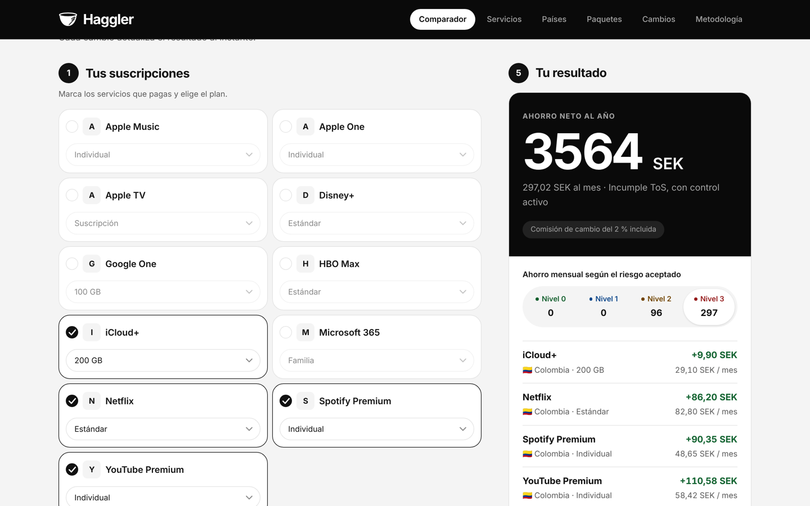
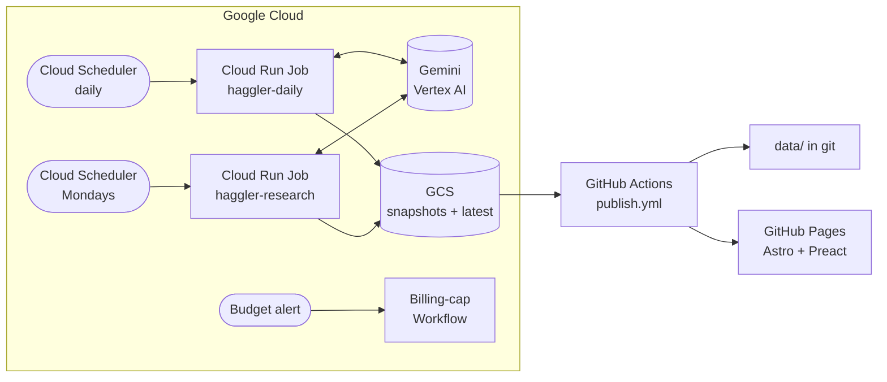

<div align="center">


# Haggler

**An agentic pipeline that tracks subscription prices across 67 countries and tells you which
cheaper offers you can actually get, and at what risk.**

[](https://github.com/glrodasz/haggler-agent/actions/workflows/ci.yml)
[](LICENSE)


[**Live site**](https://glrodasz.github.io/haggler-agent/) ·
[How it works](#how-it-works) ·
[Architecture](#architecture) ·
[Quickstart](#quickstart) ·
[Deploy](docs/SETUP.md)



</div>

## Why

Netflix, Spotify, iCloud+, YouTube Premium and friends charge very different prices depending on
the country. Comparison sites stop at the price table. The interesting question is the next one:
*given where I live, which cards I hold and which countries I have ties with, which of these
offers could I legitimately sign up for, and what would I be risking?*

Haggler answers it with a set of agents that run unattended on Google Cloud:

- **Every day** it collects official prices for 14 services in 67 countries, normalizes them to a
  monthly price in any currency and publishes every change as a reviewable git diff.
- **Every week** a research agent investigates each service's country rules, payment methods and
  bundle offers, and only keeps facts it can prove with a literal quote from a source it fetched
  itself.
- **On the site** a visitor describes their residence and ties with any country, and the comparator
  ranks savings by risk level, with the reasoning behind each verdict.

## Design principles

Haggler is built around one idea: **an LLM can propose, but only deterministic code can decide.**

| Principle | In practice |
|---|---|
| **LLM as a fallback, not a foundation** | Deterministic parsers extract prices first. Gemini only runs when a parser fails, may only quote literal text from the page, and the code checks that both the price and the quote exist in the fetched document. |
| **Grounded or discarded** | Research agents use Google Search with structured output, but a fact only counts when *our own* fetch (respecting robots.txt, never bypassing blocks) finds the cited quote on the page. Sources are classed as official, press or forum. |
| **Closed vocabulary** | Agents answer with a fixed set of fact types ([`research/fields.py`](src/haggler/research/fields.py)), so their output can be evaluated by a pure function instead of parsed from prose. |
| **Verdicts are code** | Feasibility is three separate axes (legality, terms of service, practicality), derived by [`research/evaluate.py`](src/haggler/research/evaluate.py). Any route that requires declaring false information is *not feasible*. Rules are exported as decision trees that the browser walks for arbitrary visitor profiles. |
| **Human in the loop** | New findings stay *pending review* until a maintainer accepts them by evidence hash. Bundle proposals arrive as YAML snippets for a PR, validated offline by CI. |
| **Hard cost ceilings** | Per-run caps on model calls and search queries enforced in ADK callbacks (so they also hold under `adk web`), a monthly query budget, and a Cloud Workflow that unlinks billing when actual spend reaches the budget. |
| **Everything is diffable** | Snapshots go to GCS; `data/latest/` lives in the repo, so every price change is one line in a git diff and history is append-only in `data/changes/`. |

> The site reports risks and assumptions. It is **not legal advice** and never recommends
> declaring false information.

## How it works

### Daily prices

| Step | How |
|---|---|
| Sources | Official pages addressable by country (iCloud+ support, apple.com/{country}, spotify.com/{country}, Netflix help, Microsoft Store catalog) and, for services that price by IP (YouTube Premium, Google One, HBO Max) or disallow bots in robots.txt (Disney+), each country's **App Store** in-app purchase listing. A secondary Netflix dataset (tompec, CC BY 4.0) for cross-checking. |
| Extraction | Deterministic parsers, with a quote-only Gemini fallback (see above). |
| Normalization | ECB and central bank rates via Frankfurter (COP from BanRep, ARS from BCRA…), monthly equivalent, VAT included yes/no. |
| Validation | Currency vs. country, plausible ranges, plan ordering, changes over 30 % quarantined until confirmed, last known value carried forward when a source fails. A quarantined change goes live when the next run sees the same value or an independent LLM read agrees with the parser. |
| Publishing | Full snapshots in GCS, `data/latest/` and `data/changes/*.jsonl` in the repo, static site on GitHub Pages. |

### Weekly feasibility research

| Step | How |
|---|---|
| Plan | Only service/country pairs saving at least 1 €/month and 15 % are worth researching. Caps per run (pairs, services, payment instruments) and per month (search queries). |
| Discover | Three ADK `single_turn` agents with Gemini, Google Search and structured output. |
| Verify | Our fetch must find the literal quote on the cited page or on the subject's known official pages. |
| Evaluate | The pure evaluator derives the three axes per profile: card country, presence, documents, address. Curated data wins, and upgrading a verdict requires an official source. |
| Review | `haggler research review` / `accept`. The comparator excludes unreviewed findings unless the visitor opts in. |

### Bundle monitoring

| Step | How |
|---|---|
| Values | [`data/curated/bundles.yaml`](data/curated/bundles.yaml) is the single source of truth; no job writes to it. Each value is pinned by an **anchor**, a literal quote from the official page. |
| Watch | An LLM-free watcher reads bundle pages and versioned PDF price lists on the bundle country's official domains, checks every anchor and detects new editions. |
| Propose | A search agent proposes values and requirements for up to two bundles a week. A value only counts if an official page of that country states it (value-quote check). |
| Display | Derived status (verified, needs review, manual verification, unverified, expired), monthly price with and without the 2 % currency exchange fee, savings excluding intro prices, and a verdict per profile. |

## Architecture



Both jobs are [ADK](https://google.github.io/adk-docs/) workflows: linear chains of nodes where
each node is a no-op when it receives no work, so a partial run degrades gracefully instead of failing.

```
daily:     plan_tasks → fetch_and_parse (parallel, per-item retries) → llm_extract
           → fx_normalize → validate → adjudicate (LLM second opinion) → persist

research:  plan_research → watch_bundles (no LLM) → research (agents + Google Search)
           → verify_evidence (our own fetch) → persist
```

The front end is a static Astro + Preact site. Python stays the single source of truth for
verdicts: [`profile_rules.py`](src/haggler/profile_rules.py) explores the evaluator with a
symbolic profile and publishes per-pair decision trees, which
[`web/src/logic/verdicts.ts`](web/src/logic/verdicts.ts) walks in the browser for any
residence and ties the visitor describes.

### Tech stack

**Agents:** Google ADK 2.x, Gemini on Vertex AI, Google Search grounding ·
**Backend:** Python 3.12, Pydantic, httpx, selectolax, pypdf, uv ·
**Infra:** Cloud Run Jobs, Cloud Scheduler, Cloud Storage, Cloud Workflows, Eventarc, Workload
Identity · **Front end:** Astro, Preact, TypeScript, Vitest · **CI/CD:** GitHub Actions, GitHub
Pages · **Quality:** ruff, pytest (2,300+ tests, offline replay fixtures), catalog validation in CI

## Quickstart

Requires [uv](https://docs.astral.sh/uv/) and Node.js.

```bash
uv sync
uv run pytest
uv run haggler validate-catalog

# Offline run against recorded pages: no network, no LLM
uv run haggler daily --replay tests/workflow/fixtures/replay --store local --no-llm
```

<details>
<summary><b>Real runs, site build and research commands</b></summary>

```bash
# Real run (needs internet access; LLM optional)
cp .env.example .env   # uncomment ONE option: A) GOOGLE_API_KEY (AI Studio) or B) Vertex via ADC
uv run haggler daily --store local --services netflix,spotify --countries SE,CO

# Site data and build
uv run haggler sync --from-dir .haggler --data-dir data
uv run haggler site-data --data-dir data --out web/src/data
npm --prefix web ci && npm --prefix web run build

# Feasibility research (needs an LLM with Google Search)
uv run haggler research run --store local --dry-run --no-llm   # plan only
uv run haggler research run --store local --services netflix --pairs spotify:CO
uv run haggler research review                                   # pending items and impact
uv run haggler research accept netflix --by your-username

# Bundles (docs/SETUP.md §14)
uv run haggler research run --store local --watch-only           # watcher only: 0 queries
uv run haggler research review --bundles                         # proposals and YAML snippets

# ADK development UI
PYTHONPATH=agents uv run adk web agents
```

`haggler` loads the `.env` from the working directory on startup (`uv run` does not read it on its
own) without overriding variables already set in the environment; `adk web agents` loads the `.env`
from the repo root. In `.env.example` both LLM options are commented out: with neither, the LLM
fallback is off; with both, google-genai ignores `GOOGLE_API_KEY` and calls Vertex AI.

</details>

Deploying your own instance to GCP and GitHub Pages is covered step by step in
[docs/SETUP.md](docs/SETUP.md).

## Project layout

```
src/haggler/              Python package: models, sources, fetch, fx, validation, pipelines, CLI
  pipeline/               daily ADK workflow
  research/               research workflow, evidence verification, pure evaluator
  bundles/                bundle watcher
  llm/                    model budget, grounding metadata, runner
agents/                   shims for `adk web agents` / `adk run`
catalog/                  services, plans, sources and countries (editable YAML)
data/latest/              latest published prices (managed by the bot)
data/changes/             price change history (append-only)
data/curated/             feasibility, profiles, reviews, bundles, payment instruments
data/research/            verified facts and bundle watcher state (bot)
web/                      static site (Astro + Preact)
infra/                    GCP bootstrap and billing kill switch
.github/workflows/        CI, probe, job deployment, publishing
```

## Roadmap

- [x] **Phase 1:** daily per-country prices and the public site.
- [x] **Phase 2:** weekly feasibility research agent (quote-verified facts, deterministic
  per-profile evaluator, human review by evidence hash), comparator for any residence and ties.
- [ ] **Phase 3 (current):** bundle monitoring (Meli+, Telia, Apple One…). Done: canonical YAML
  with anchors, LLM-free watcher of official pages and PDFs, propose-only agent, derived status,
  per-profile verdicts. Pending: first-wave anchors and the second wave (Telia Play).
- [ ] **Phase 4:** in-browser combination optimizer (one region per Apple/Google account, limits
  on foreign payment instruments, bundles as virtual SKUs).

## Contributing

Issues and pull requests are welcome. Adding a country or a service is mostly YAML in
[`catalog/`](catalog); `uv run haggler validate-catalog` checks it, and CI runs ruff, pytest and
the catalog validation on every push.

## License

[Apache-2.0](LICENSE). Prices belong to their respective providers; the Netflix dataset from
[tompec/netflix-prices](https://github.com/tompec/netflix-prices) is used under CC BY 4.0.

<sub>Built by [Guillermo Rodas](https://github.com/glrodasz).</sub>
