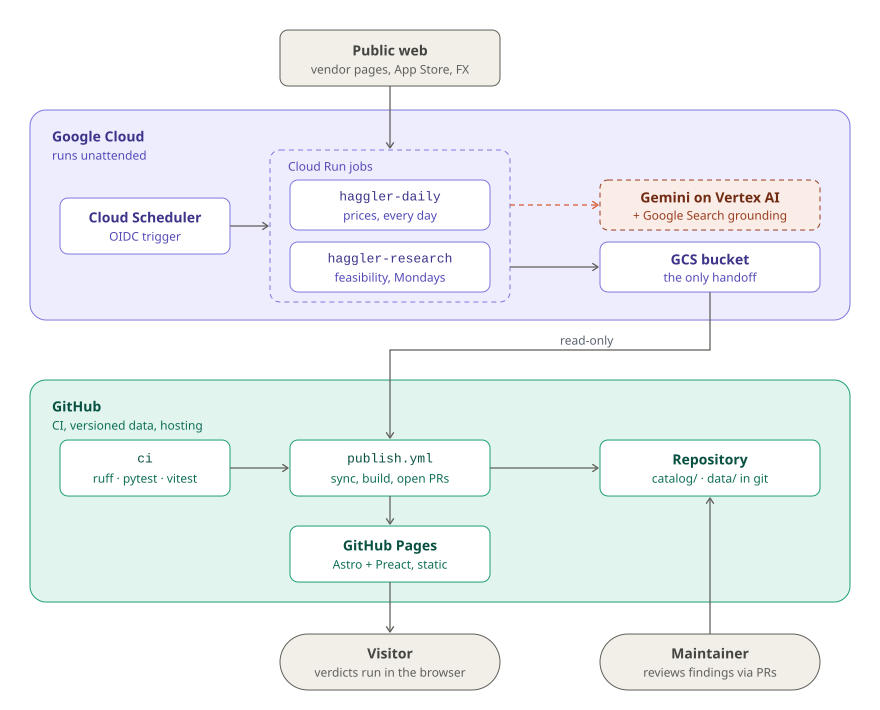
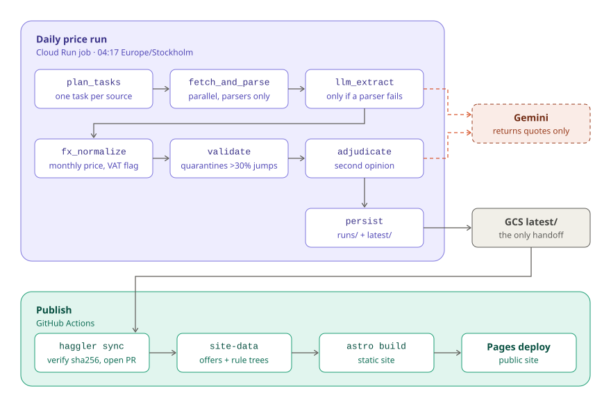
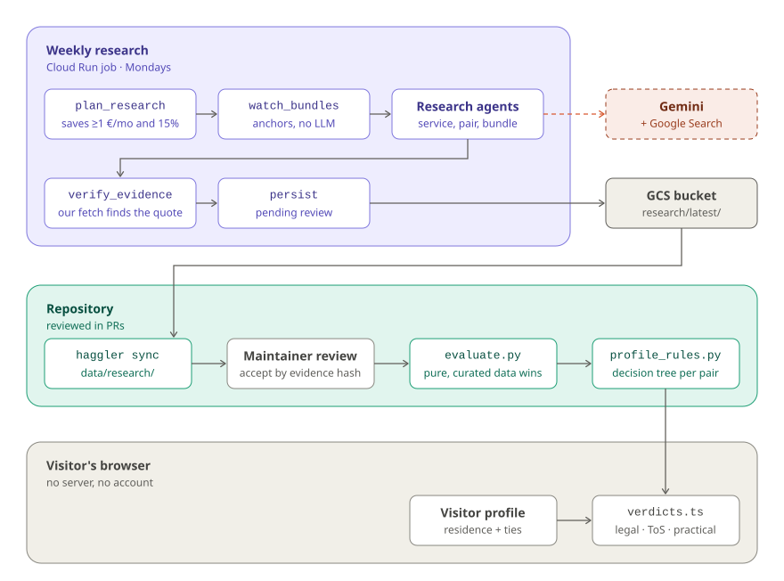

# Architecture

How Haggler is built, one level below the [system context in the README](../README.md#architecture):
what runs where, how a price travels from a vendor page to the site, and how a research finding
becomes a verdict in the visitor's browser.

**Reading the diagrams:** purple is Google Cloud, teal is GitHub, gray is people, the public web
and storage handoffs. **Dashed coral arrows are Gemini calls**; everything else is deterministic
code.

## Containers: what runs where

<picture>
  <source media="(prefers-color-scheme: dark)" srcset="diagrams/containers-dark.svg">
  
</picture>

The bucket is the only handoff: the jobs never touch git and Actions never write to the bucket.
Nothing runs server-side for a visitor; the site is static files and the comparator runs in the
browser. A spent budget unlinks billing, which stops both jobs.

## Daily: from vendor page to published price

<picture>
  <source media="(prefers-color-scheme: dark)" srcset="diagrams/daily-prices-dark.svg">
  
</picture>

Both jobs are [ADK](https://google.github.io/adk-docs/) workflows. Every node is a no-op when it
receives no work, so a partial run degrades instead of failing, and a
failed source carries its last known value forward. Gemini only returns quotes: the code checks the
quoted price exists in the page text before keeping it. The site deploys from the synced files
whether or not the data-sync PR is merged; merging it only versions them in `data/`.

## Weekly research: from a hunch to a verdict

<picture>
  <source media="(prefers-color-scheme: dark)" srcset="diagrams/research-verdicts-dark.svg">
  
</picture>

The agents only discover. Fetched page text never goes back to the model, a fact without a verified
quote is dropped, and any route that needs a false declaration is "not feasible" by rule. Findings
become reviewed once a maintainer accepts them (`haggler research review` / `accept`, or by merging
the `research-review` PR that `publish` opens with proposed decisions); until then the comparator
still counts them, marked *pending review*.

The front end is a static Astro + Preact site. Python stays the single source of truth for
verdicts: [`profile_rules.py`](../src/haggler/profile_rules.py) explores the evaluator with a
symbolic profile and publishes per-pair decision trees, which
[`web/src/logic/verdicts.ts`](../web/src/logic/verdicts.ts) walks in the browser for any
residence and ties the visitor describes.

## See also

- [Setup and deployment](SETUP.md): GCP bootstrap, workflows, budgets and the billing kill switch.
- [Design principles](../README.md#design-principles) and [How it works](../README.md#how-it-works) in the README.
